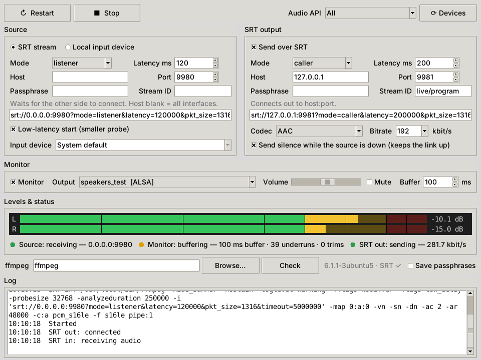

# SRT Audio Bridge

Receive audio over SRT (or from a local input), listen to it on any output device, and forward it to another SRT destination. Cross-platform (Windows, macOS, Linux), one Python file, with a small GUI and a headless mode.



```
SRT in ----ffmpeg decode----> PCM 48 kHz s16 stereo --+--> monitor output device
local input device ---------------------------------->+--> ffmpeg encode --> SRT out
```

ffmpeg does the SRT, decoding and encoding. Audio devices go through PortAudio (`sounddevice`), because ffmpeg can't pick a playback device on Windows and its device syntax differs per OS.

## Install

1. Python 3.9+ with tkinter
   - Debian/Ubuntu: `sudo apt install python3-tk libportaudio2`
   - macOS (Homebrew Python): `brew install python-tk`
   - Windows: the python.org installer includes tkinter
2. `pip install -r requirements.txt`
3. ffmpeg with SRT support, on `PATH` or picked in the GUI. Check with
   `ffmpeg -hide_banner -protocols | grep srt`
   - Windows: gyan.dev or BtbN builds include libsrt
   - macOS: `brew install ffmpeg`
   - Linux: most distro builds include libsrt

## Run

```
python srt_audio_bridge.py                  # GUI
python srt_audio_bridge.py --list-devices   # print audio devices
python srt_audio_bridge.py --headless       # run the last saved settings, no GUI
python srt_audio_bridge.py --config venue-a.json   # use another settings file (presets)
```

Settings are saved to `~/.srt_audio_bridge.json` when you press Start. Passphrases are only saved when "Save passphrases" is ticked.

## Behaviour

- **Source:** SRT (caller, listener or rendezvous, with latency, passphrase, stream ID) or a local input device. With an audio+video SRT feed, the first audio track is used.
- **Monitor:** output device, volume, mute and buffer size can be changed while running.
- **SRT out:** MPEG-TS with AAC, MP2, Opus or PCM (SMPTE 302M). Keeps the link up with silence while the source is down.
- **Reconnects:** SRT in and SRT out reconnect on their own and independently, so a dead destination never stops monitoring.
- **Latency:** bursts of old audio (after a reconnect or ffmpeg's start-up probe) are dropped instead of becoming permanent delay. Measured end to end with two 120 ms SRT hops and AAC: about 400 ms.

## Platform notes

- **Windows:** use the "Windows WASAPI" audio API (picked by default). It resamples devices not set to 48 kHz.
- **macOS:** the first time you use a local input, allow microphone access for your terminal or Python.
- **Security:** passphrases are masked in the log, and the settings file is created with 0600 permissions. ffmpeg still receives them on its command line, so other local users can see them in the process list.

## Test

```
python tests/e2e_relay.py                                  # bridge calls the destination
python tests/e2e_relay.py --out-mode listener --join-after 5   # destination joins late
```

Sends tone pulses over SRT through the bridge (headless, monitoring off) to a receiver and checks every pulse arrives intact within the latency limit. Needs ffmpeg with SRT and numpy, no sound card.
